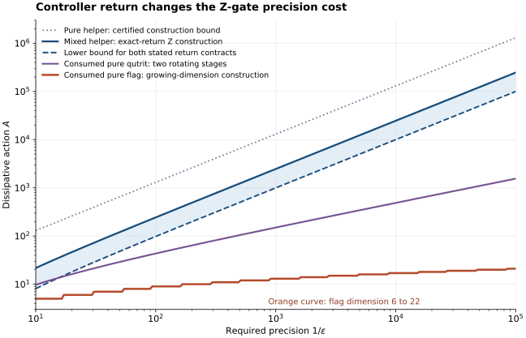

# Dissipative gates: the cost of returning the controller

How much dissipative action does an accurate quantum gate require when the controller must be returned? This repository gives a dimension-independent lower bound and explicit constructions in one control model: a predetermined sequence of Hermitian Lindblad jumps, with zero Hamiltonian and unobserved bath outcomes.

For an initially pure controller that is approximately returned together with the gate output, the optimal action is proportional to the inverse error. The same lower bound holds for an arbitrary finite mixed controller whose marginal is returned exactly. Allowing an initialized pure controller to change its state gives a different accuracy dependence: a fixed qutrit achieves inverse-square error in the action, and a growing flag register achieves exponential error suppression. All gate errors are complete-channel distances, so the guarantees include inputs entangled with a reference.

## Model and main results

The data system $`S`$ and controller $`C`$ evolve under

```math
\dot\sigma_t=\mathcal L_t(\sigma_t),\qquad
\mathcal L_t(X)=-\frac12\sum_j[L_j(t),[L_j(t),X]],
\qquad L_j(t)=L_j(t)^\dagger.
```

The dimensionless action is defined from the generator itself:

```math
A=\frac12\int_0^T\|\mathcal L_t\|_{2\to2}\,dt.
```

Here $`\|\cdot\|_{2\to2}`$ is the induced norm on Hilbert–Schmidt operator space. It is independent of the chosen Hermitian-jump representation. For a supplied list of jumps, $`A\le\int\sum_j\|L_j(t)\|_\infty^2dt`$. Equality holds for the individual stages in the explicit constructions.

For the target $`\mathcal U(\rho)=U\rho U^\dagger`$, define its displacement from doing nothing by $`s(U)=\tfrac12\|\mathcal U-\mathrm{id}\|_\diamond`$. A fixed nontrivial target has $`s(U)>0`$. Under either return contract below, the error obeys

```math
\boxed{(s(U)-\epsilon)_+^2\le A\epsilon.}
```

| Controller requirement | Error being controlled | Established result |
|---|---|---|
| Pure controller, approximate joint return to its supplied state | Half-diamond distance of the entire data-plus-controller channel from $`\rho\mapsto U\rho U^\dagger\otimes\lvert0\rangle\langle0\rvert`$ | Optimal $`A_{\min}=\Theta_U(\epsilon^{-1})`$ for every fixed nontrivial $`U`$. One controller qubit suffices for the upper bound. |
| Arbitrary finite mixed controller, exact marginal return | Data-channel half-diamond error; controller correlations are allowed | $`A=\Omega_U(\epsilon^{-1})`$, independent of controller dimension and spectrum. A maximally mixed controller qubit attains this order for $`Z`$. |
| Pure controller of fixed dimension $`D=m+1`$, allowed to change | Data-channel half-diamond error | Achievable $`\epsilon=O_U(A^{-m})`$ at fixed $`m`$. One qutrit gives $`O(A^{-2})`$. No optimal exponent is asserted. |
| Pure controller with increasing flag dimension, allowed to change | Data-channel error and joint error relative to a specified changed controller state | Achievable $`A=O_U(\log(1/\epsilon))`$ with $`D=O_U(\log(1/\epsilon))`$. No unrestricted matching converse is asserted. |

The mixed-controller converse needs exact marginal return only on the maximally mixed data input. If the controller is itself initially maximally mixed, that condition is automatic under unital dynamics. The inverse-error lower bound then applies even when its output is discarded.



The plot uses $`U=Z`$ and $`s(Z)=1`$. The dashed curve is the lower bound for the two return contracts stated in the table. The solid blue curve is the exact mixed-return construction; the dotted curve is a sufficient action bound for approximate pure joint return. The purple curve uses a fixed qutrit. The orange curve uses exchange stages of action one and counts every flag level. The shaded interval brackets the optimal action under exact mixed marginal return; its coefficient is not resolved. [Plot data and reproduction](verification/README.md).

## Why returning the controller matters

Hermitian-jump evolution decreases joint purity. Its speed and purity loss satisfy the exact trajectory inequality

```math
\|\sigma_T-\sigma_0\|_2^2
\le A\left(\operatorname{Tr}\sigma_0^2-\operatorname{Tr}\sigma_T^2\right).
```

A nontrivial gate moves a suitable pure input by a finite distance. Approximate joint return requires the full final output to be close to another pure state, which permits only a small purity loss. Combining the two facts forces the inverse-error action law. For an exactly returned mixed controller, a stationary-product argument and a weighted Hilbert–Schmidt norm give the same conclusion without a dimension or spectral factor.

A changed controller can retain the unsuccessful part of an unconditioned evolution in a separate flag. Later stages address that remaining part while leaving earlier completed branches untouched. Tracing out the flags then gives an exact mixture of the desired unitary and the identity. The fixed-qutrit construction shows that an improved error exponent does not require growing controller dimension. Its controller entropy can even tend to zero, although its state is far from the supplied state. The return requirement therefore concerns the actual controller state and correlations, not just its entropy.

## Read the scientific account

Start with the [model, result map, and physical interpretation](science/README.md). The connected proofs are organized by the operational question:

1. [Returned pure controller: the universal lower bound](science/return-law.md).
2. [One helper qubit: a matching complete-channel construction](science/pure-helper.md).
3. [Exactly returned mixed controllers: weighted proof and an explicit gate](science/mixed-controllers.md).
4. [Consumed flags: an exponential construction and its resource accounting](science/consumed-controllers.md).
5. [Fixed controller dimension: a hierarchy of attainable error powers](science/fixed-dimension-controllers.md).

The [related-work comparison](references/RELATED_WORK.md) distinguishes the contribution from established Zeno control, fidelity–dissipation bounds, catalytic structure, and dissipative flag constructions. The [bibliography](references/references.bib) records the primary sources.

## Learn the project

The [learning route](learning/README.md) uses Howard M. Wiseman and Gerard J. Milburn's *Quantum Measurement and Control* (2010) as its single educational anchor. Begin with the [source-to-project bridge](learning/ANCHOR_BRIDGE.md), which connects measurement and dephasing to complete-channel gate accuracy, controller return, and the action budget. The bridge supplies the project-specific steps rather than requiring the whole book first.

The [30-milestone map](learning/MILESTONES.md) develops the background and then the scientific argument, from individual mechanisms to the full comparison. It is a common map of the project's understanding targets. Readers seeking exact statements and proofs can use the scientific route above directly.

## Scope and reproducibility

The schedule is deterministic and the terminal time is fixed. There is no bath monitoring, feedback, postselection, intermediate reset, fresh helper injection, or supplied coherent encoder or decoder. A rotating frame used to solve an equation is not an extra physical Hamiltonian. The target-dependent jump operators and their addressing are supplied controls; their engineering or compilation cost is not included in $`A`$. The result is an action–accuracy comparison within this model, rather than a claim about ordinary gate count, heat, or hardware advantage.

The general claims follow from analytical proofs. [Verification](verification/README.md) independently integrates the explicit Lindblad dynamics, checks their reference-extended channels against the reduced equations, and records numerical residuals. A finite Choi-state diagnostic is distinguished from a proved diamond-norm bound. The repository does not establish an optimal disposable-controller cost, exponential accuracy at fixed controller dimension, or a dimension-uniform theorem for arbitrary approximately returned mixed controllers.

## Purpose and contact

This repository serves as a record of the work and a guide for the author’s self-directed learning. For discussion or potential collaboration, please contact Ruge Lin at [gogoko699@gmail.com](mailto:gogoko699@gmail.com).

The repository retains its [MIT license](LICENSE).
